<h1 style="background-color: rgb(134, 227, 182); color: rgb(0, 0, 0)"> Critical Point Problem </h1>

# Definitions

Let $\{\tau_1, \tau_2, \dots, \tau_n\}$ be arbitrary distinct ordered nodes with $\tau_i \in [-1, 1]$.

### Lagrange polynomial $L_i^n(t)$ associated with $\tau_i$

$$
L_i^n(t) = \prod_{\substack{j=1\\j\ne i}}^n \frac{t-\tau_j}{\tau_i-\tau_j}, \qquad i=1,\dots,n.
$$

For convenience, define $D_i^n = \prod_{\substack{j=1\\j\ne i}}^n (\tau_i-\tau_j)$.

### Quadrature weight $\omega_i^n$ associated with $\tau_i$

$$
\omega_i^n = \int_{-1}^{1} L_i^n(t)\,dt, \qquad i=1,\dots,n.
$$

### Normalized Lagrange polynomial $\tilde L_i^n(t)$

Throughout, we assume $\omega_i^n\ne0$ for all $i=1,\dots,n$, so that $\tilde L_i^n$ is well defined. (For arbitrary nodes the weights may be negative, but they must not vanish.)

$$
\tilde L_i^n(t) = \frac{L_i^n(t)}{\omega_i^n}, \qquad i=1,\dots,n.
$$

### Cumulative Lagrange polynomial $G_i^n(t)$

$$
G_i^n(t)=\int_{-1}^{t}\tilde L_i^n(s)\,ds-\frac12, \qquad i=1,\dots,n.
$$

For the endpoint indices, define $G_0^n(t)=\frac12$ and $G_{n+1}^n(t)=-\frac12$.

### Basis polynomial $F_i^n(t)$

$$
F_i^n(t)=G_i^n(t)-G_{i+1}^n(t), \qquad i=0,1,\dots,n.
$$

For $i=1,\dots,n-1$, the constants $-\frac12$ cancel, so

$$
\begin{aligned}
F_i^n(t)&=\int_{-1}^{t}\frac{L_i^n(s)}{\omega_i^n}\,ds-\int_{-1}^{t}\frac{L_{i+1}^n(s)}{\omega_{i+1}^n}\,ds\\
&=\int_{-1}^{t}\left(\frac{L_i^n(s)}{\omega_i^n}-\frac{L_{i+1}^n(s)}{\omega_{i+1}^n}\right)ds,
\qquad i=1,\dots,n-1.
\end{aligned}
$$

For the endpoint indices,

$$
F_0^n(t)=1-\int_{-1}^{t}\tilde L_1^n(s)\,ds,\qquad
F_n^n(t)=\int_{-1}^{t}\tilde L_n^n(s)\,ds.
$$

   

# Critical points of $F_i^n(t)$ with the ordered nodes $\{\tau_1,\tau_2,\dots,\tau_n\}$

## 1) $i=1,\dots,n-1$

$$
\begin{aligned}
\frac{d}{dt}F_i^n(t)=0
&\iff \frac{L_i^n(t)}{\omega_i^n}=\frac{L_{i+1}^n(t)}{\omega_{i+1}^n}\\
&\iff \prod_{\substack{j=1\\j\notin\{i,i+1\}}}^{n}(t-\tau_j)\left\{\alpha(t-\tau_{i+1})-\beta(t-\tau_i)\right\}=0,
\end{aligned}
$$

where $\alpha=\frac{\omega_{i+1}^n}{D_i^n}$ and $\beta=\frac{\omega_i^n}{D_{i+1}^n}$.

If $\alpha\ne\beta$, the critical points are $t=\tau_k$ for $k\ne i,i+1$, or

$$
t=t^*:=\frac{\alpha\tau_{i+1}-\beta\tau_i}{\alpha-\beta}.
$$

## 2) $i=0,n$

$$
\frac{d}{dt}F_0^n(t)=-\tilde L_1^n(t)\quad\Rightarrow\quad t=\tau_2,\tau_3,\dots,\tau_n,
$$

$$
\frac{d}{dt}F_n^n(t)=\tilde L_n^n(t)\quad\Rightarrow\quad t=\tau_1,\tau_2,\dots,\tau_{n-1}.
$$

There does not exist $t^*$ at the endpoint basis indices.

   

# Special cases of $t^*$

## 1) $\alpha=\beta$

In this case,

$$
(\alpha-\beta)t=\alpha\tau_{i+1}-\beta\tau_i=\alpha(\tau_{i+1}-\tau_i)\ne0,
$$

so the linear equation determining the additional critical point has no real solution. Thus $F$ only has $n-2$ critical points.

## 2) $t^*=\tau_k$, $k\ne i$, $k\ne i+1$

In this case, $\frac{d}{dt}F$ has a double root at $\tau_k$.

   

# Sign of $\frac{d^2}{dt^2}F_i^n(\tau_k)$, $k\ne i$, $k\ne i+1$

Assume $\omega_j^n>0$ for all $j=1,\dots,n$ throughout this section.

Consider

$$
\frac{d}{dt}\tilde L_i^n(t)=\frac{1}{\omega_i^nD_i^n}\frac{d}{dt}\left(\prod_{\substack{j=1\\j\ne i}}^n(t-\tau_j)\right).
$$

$$
\frac{d}{dt}\tilde L_i^n(\tau_k)=\frac{1}{\omega_i^nD_i^n}\prod_{\substack{j=1\\j\ne i,k}}^n(\tau_k-\tau_j).
$$

Since the nodes are ordered, the sign of the product is determined by the number of negative terms. It is $n-k-1$ if $k<i$ and $n-k$ if $k>i+1$. The number of negative terms in $D_i^n$ is $n-i$.

Then the sign of $\frac{d}{dt}\tilde L_i^n(\tau_k)$ is determined by $2n-i-k-1$ or $2n-i-k$ negative terms with positive weights. Since $2n$ is always even, the sign is determined by $i$ and $k$.

Similarly, the sign of $\frac{d}{dt}\tilde L_{i+1}^n(\tau_k)$ is determined by $i$ and $k$ and is opposite to that of $\frac{d}{dt}\tilde L_i^n(\tau_k)$.

By the definition of $F_i^n$, the sign of $\frac{d^2}{dt^2}F_i^n(\tau_k)$, $k\ne i,k\ne i+1$, is as follows.

| Position of $k$ | $i+k$ | Sign of $\frac{d^2}{dt^2}F_i^n(\tau_k)$ |
| --- | --- | --- |
| $k<i$ | even | $(-1)^{i+k+1}=-1$ |
| $k<i$ | odd | $(-1)^{i+k+1}=+1$ |
| $k>i+1$ | even | $(-1)^{i+k}=+1$ |
| $k>i+1$ | odd | $(-1)^{i+k}=-1$ |

## Endpoint indices $i=0,n$

The endpoint definitions $G_0^n=\frac12$ and $G_{n+1}^n=-\frac12$ are constant. Hence

$$
(F_0^n)''(t)=-(\tilde L_1^n)'(t),\qquad
(F_n^n)''(t)=(\tilde L_n^n)'(t).
$$

For $k=2,\dots,n$, the numerator of $(\tilde L_1^n)'(\tau_k)$ has $n-k$ negative factors, while $D_1^n$ has $n-1$. Since $\omega_1^n>0$,

$$
\operatorname{sgn}(F_0^n)''(\tau_k)=(-1)^k.
$$

For $k=1,\dots,n-1$, the numerator of $(\tilde L_n^n)'(\tau_k)$ has $n-k-1$ negative factors, while $D_n^n$ has none. Since $\omega_n^n>0$,

$$
\operatorname{sgn}(F_n^n)''(\tau_k)=(-1)^{n-k-1}=(-1)^{n+k+1}.
$$

Thus the table above also holds at $i=0$ (only $k>i+1$) and $i=n$ (only $k<i$). Together, it covers $i=0,\dots,n$ and the applicable node critical points.

   

# Position of $t^*$

- t* is defined under $\omega \neq 0$
- $D_i^n \neq 0$ with the distinct node
- So, $\alpha \neq 0$ and $\beta \neq 0$
- $
\alpha\beta=\frac{\omega_{i+1}^n}{D_i^n}\frac{\omega_i^n}{D_{i+1}^n}.
$

$t^*$ divides the segment from $\tau_i$ to $\tau_{i+1}$ in the ratio $\alpha:-\beta$. We can consider 3 cases.
1. $t^*$ lies on $\tau_i$ or $\tau_{i+1}$.
2. $t^*$ is the internal division point of  $\tau_i$ and $\tau_{i+1}$.
3. $t^*$ is the external division point of  $\tau_i$ and $\tau_{i+1}$. 

### 1. $t^*$ lies on $\tau_i$ or $\tau_{i+1}$ 
Since $\alpha \neq 0$ and $\beta \neq 0$, this case is impossible.

### 2. $t^*$ is the internal division point of  $\tau_i$ and $\tau_{i+1}$.
$
   \iff \alpha(-\beta) > 0 
\\ \iff \alpha\beta < 0
\\ \iff \omega_i^n \omega_{i+1}^n > 0 \qquad \because D_i^n D_{i+1}^n < 0
\\ \iff \omega_i^n$ and $ \omega_{i+1}^n$ have the same sign.

### 3. $t^*$ is the external division point of  $\tau_i$ and $\tau_{i+1}$.
$
   \iff \alpha(-\beta) < 0 
\\ \iff \alpha\beta > 0
\\ \iff \omega_i^n \omega_{i+1}^n < 0 \qquad \because D_i^n D_{i+1}^n < 0
\\ \iff \omega_i^n$ and $ \omega_{i+1}^n$ have different signs.
$\\ \Longrightarrow \exist \omega <0$ 

### useful facts
1. Under the positive weights condition, $t^*$ is always the internal division point
2. With distinct nodes, if $t^*$ is the external division point, then there exists a nonpositive weight.

   

# New notation of $t^*$

Under the positive weight condition, $t^*$ is the internal point of $\tau_i$ and $\tau_{i+1}$. So from now on, we denote $t^*$ by $\tau_{i+0.5}$, because in many examples it is more understandable. It does not mean the geometrical midpoint of $\tau_i$ and $\tau_{i+1}$.

   

# $t^*$ is the local maximizer

For $i=1,\dots,n-1$, assume that all quadrature weights are positive. By the interpolation property of the Lagrange polynomials,

$$
\frac{d}{dt}F_i^n(\tau_i)=\frac{1}{\omega_i^n}>0,
\qquad
\frac{d}{dt}F_i^n(\tau_{i+1})=-\frac{1}{\omega_{i+1}^n}<0.
$$

Since $t^*=\tau_{i+0.5}$ is the unique critical point in $(\tau_i,\tau_{i+1})$, the derivative changes from positive to negative at $t^*$. Therefore, $t^*$ is a local maximum point of $F_i^n$.

   

# $t^*$ is not necessarily a global maximizer

Even if the nodes are symmetric about zero, include both endpoints, and have positive quadrature weights, $t^*$ need not be a global maximizer on $[-1,1]$.

For example, consider the six nodes

$$
(\tau_1,\dots,\tau_6)=\left(-1,-\frac12,-\frac15,\frac15,\frac12,1\right).
$$

Their quadrature weights are all positive:

$$
(\omega_1^6,\dots,\omega_6^6)=\left(\frac{17}{108},\frac{128}{189},\frac{125}{756},\frac{125}{756},\frac{128}{189},\frac{17}{108}\right).
$$

The corresponding basis polynomial is

$$
F_3^6(t)=-\frac{25}{8}(t^2-1)^2(8t^2+1).
$$

Its critical point between $\tau_3$ and $\tau_4$ is $t^*=0$, which is a local maximum. However,

$$
F_3^6(0)=-\frac{25}{8}<0=F_3^6(-1)=F_3^6(1).
$$

Thus $t^*$ is not a global maximizer on $[-1,1]$.

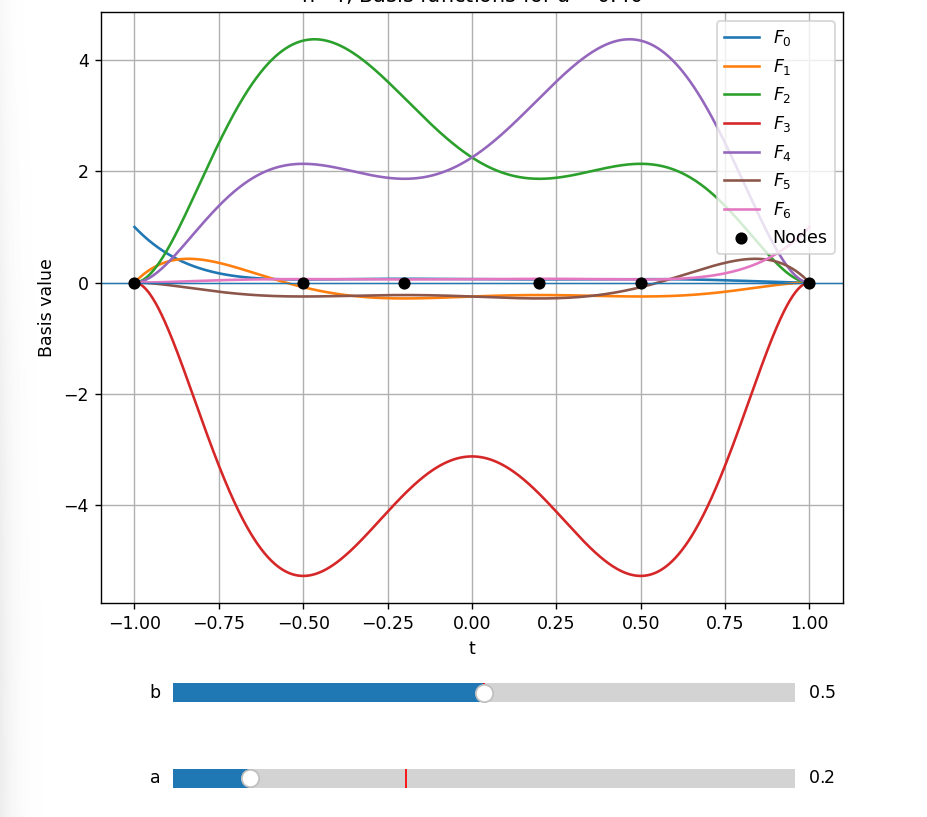

   

<h1 style="background-color: rgb(134, 227, 182); color: rgb(0, 0, 0)"> Minimize Variance Problem </h1>

# Minimizing the variance of the maxima of F

We make the following assumptions.
- If the maxima of the basis functions are close to one another, the curve is more predictable.
- Likewise, the smaller the variance of the maxima, the more predictable the curve.
- If the maxima of the inner basis functions are close to one another, their minima are also close.

   

# Definitions

### Inner basis functions
We call $F_1^n, F_2^n, \dots, F_{n-1}^n$, i.e., the basis functions excluding the endpoint indices $i=0$ and $i=n$, the *inner basis functions*.

### Maximum of a basis function
Let $\tau = (\tau_1, \dots, \tau_n)$ be a strictly increasing sequence of nodes.  
For $i = 0, 1, \dots, n$, define the maximum of $F_i^n$ by
$$M_i^n(\tau) = \max_{t\in[-1,1]} F_i^n(t).$$

### Average and variance of the maxima
Define the average $\bar{M}(\tau)$ and the variance $\operatorname{Var}(\tau)$ of the maxima of the inner basis functions by

$$
\bar M(\tau)=\frac{1}{n-1}\sum_{i=1}^{n-1}M_i^n(\tau),\qquad
\operatorname{Var}(\tau)=\frac{1}{n-1}\sum_{i=1}^{n-1}\bigl(M_i^n(\tau)-\bar M(\tau)\bigr)^2 .
$$

   

# 탐색 방법

### 고려 사항
- 목적함수(분산)은 $\tau$에 따라 연속이지만 미분 불가능
- 즉, Gradient Discnet 사용 어려움 
- 분산을 하나 평가하는데 비용은 100ms 미만

### 후보1 : grid search
자유변수들의 격자점을 모두 탐색

장점: 국소최솟값 문제를 고민 안해도 됨
단점: 자유변수 개수 n에 따라 $격자 개수^n $만큼 탐색하여 차수가 증가할수록 비용이 많이 듦

### 후보2 : compass search
노드를 자유변수 하나만 +h, -h 로 움직여 후보를 생성
자유 변수 n에 따라 총 2n개의 후보를 살펴보고 분산이 최소가 되는 노드로 이동

장점: 간단한 구현, 낮은 비용
단점: 대각선에 낮은 비용이 위치하는 경우, 놓칠 수 있음

### 후보3 : compass search with diagonal
compass search를 대각선을 포함하여 실행
자유 변수 n개에 따라 총 $3^n - 1$개의 후보를 살펴봄

장점: 간단한 구현
단점: compass search보다 비싼 비용

### 후보4 : Mesh Adaptive Direct Search
n차원 격자점의 집합(mesh)의 간격과 poll의 크기, mesh의 후보점들을 기준에 따라 정하여 탐색하는 방법

- 공부 더 필요함

   

# Compass Search

1. 차수 n, 탐색 간격 h, 종료 조건 h_limit, 초기 노드 initial node 를 입력
2. 초기 노드의 분산을 계산
3. 하나의 자유변수에 +h, -h 연산을 수행한 후보 노드에 대해 분산을 계산
4. 3을 모든 자유변수에 대해 반복
5. 초기 분산과 후보 분산들 중 최솟값 탐색
6. 최솟값이 나오는 노드가 초기 노드일 경우, 탐색 간격을 10분의 1로 조정
7. 최솟값이 나오는 노드가 탐색 노드일 경우, 해당 노드를 초기 노드로 설정

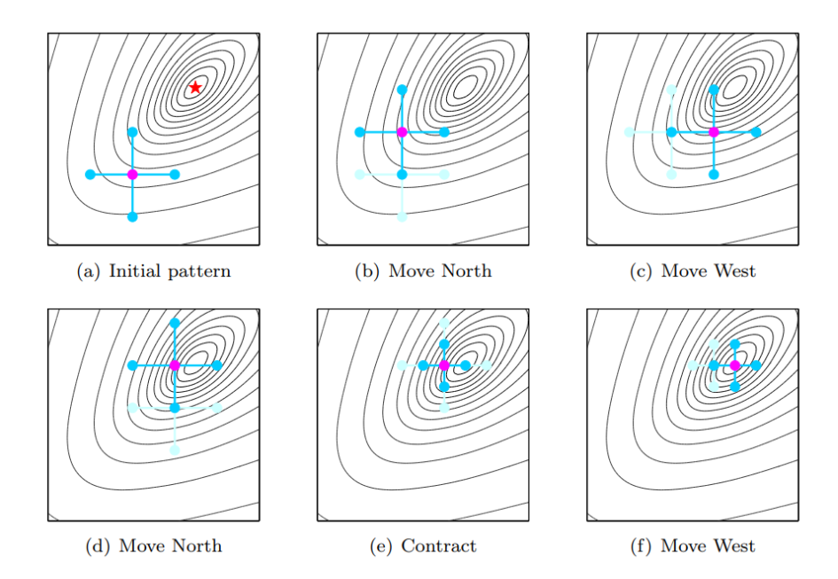

---

### n = 4

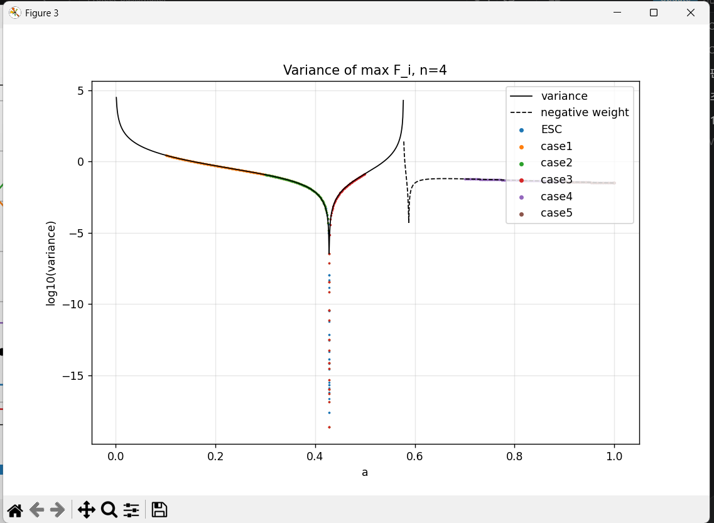

  93    0.000000000100000 2.333690955214700e-19  [-1.00000000000000000000, -0.42818182699999973728, 0.42818182699999973728, 1.00000000000000000000]
[case3] a=0.42818183, sympy check: 2.333688426932632e-19

---

### n=5

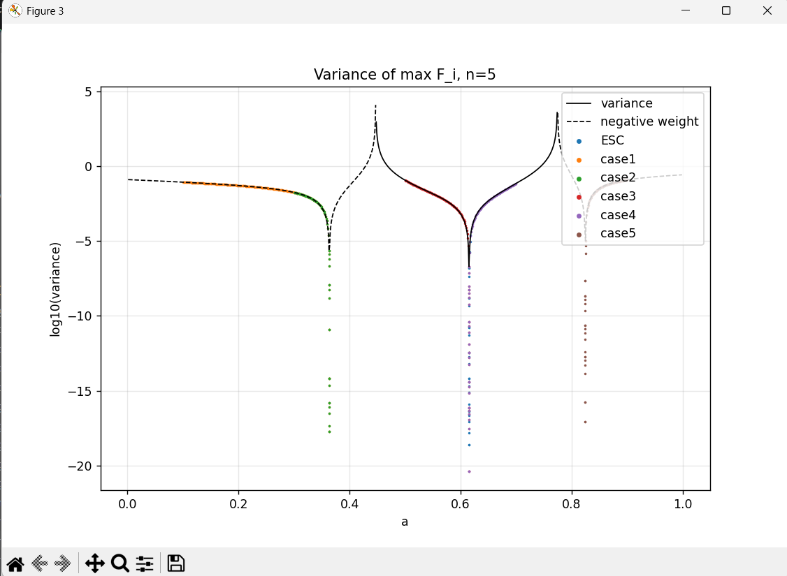
[ESC] a=0.61525633, sympy check: 2.467236153920099e-19
[case1] a=0.36343098, sympy check: 1.971465173421264e-18
[case2] a=0.36343098, sympy check: 1.971466108732261e-18
[case3] a=0.61525634, sympy check: 4.025324281057727e-21
[case4] a=0.61525634, sympy check: 4.025370066276577e-21
[case5] a=0.82468554, sympy check: 8.877902265598494e-18

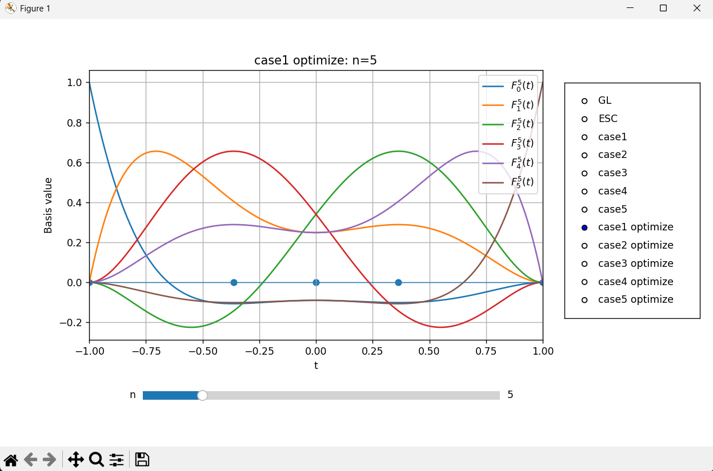
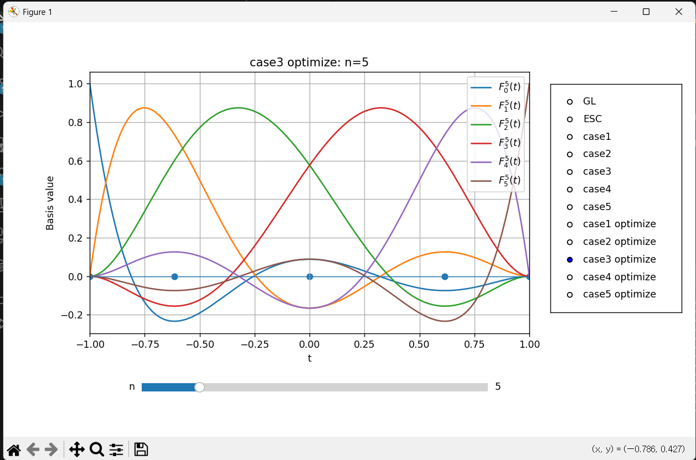
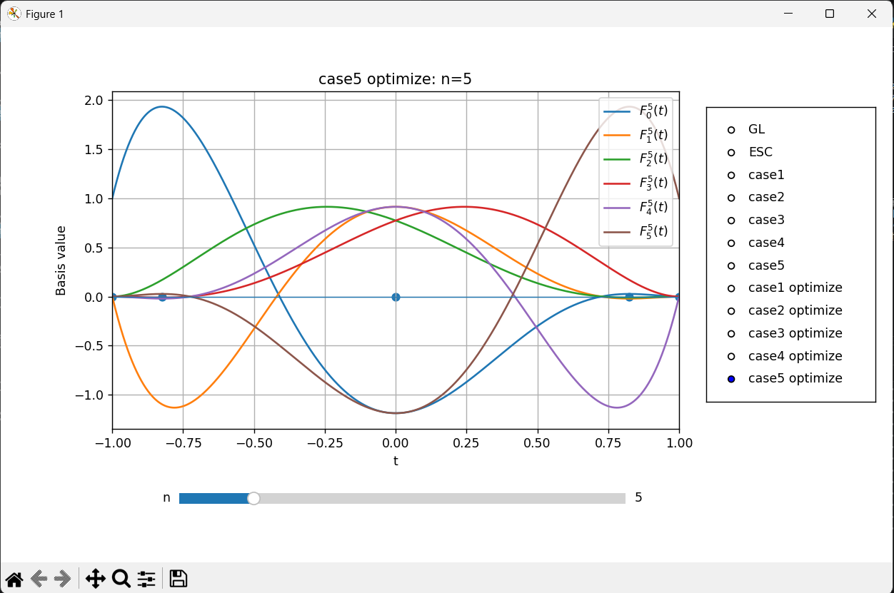

---

### n=6

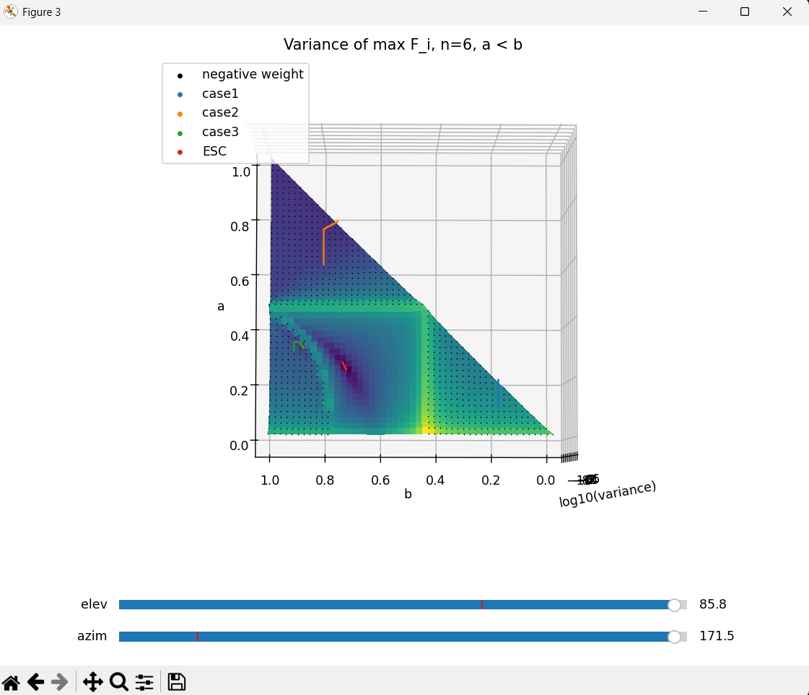
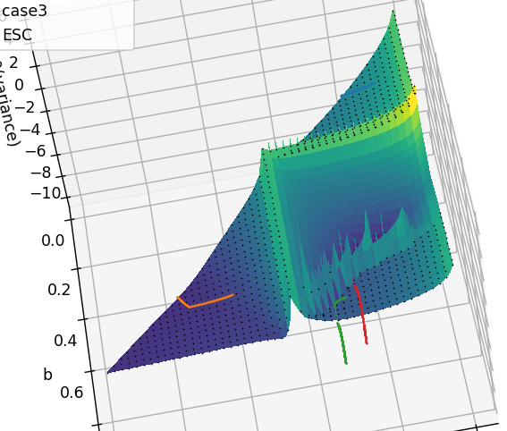
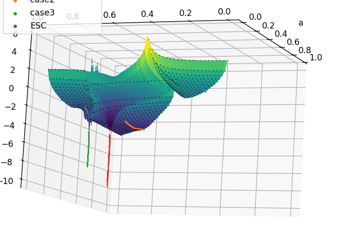

sympy check: 1.806596360179689e+00
sympy check: 1.356292541170561e-02
sympy check: 3.425611140052588e-08
sympy check: 1.591464508424902e-10

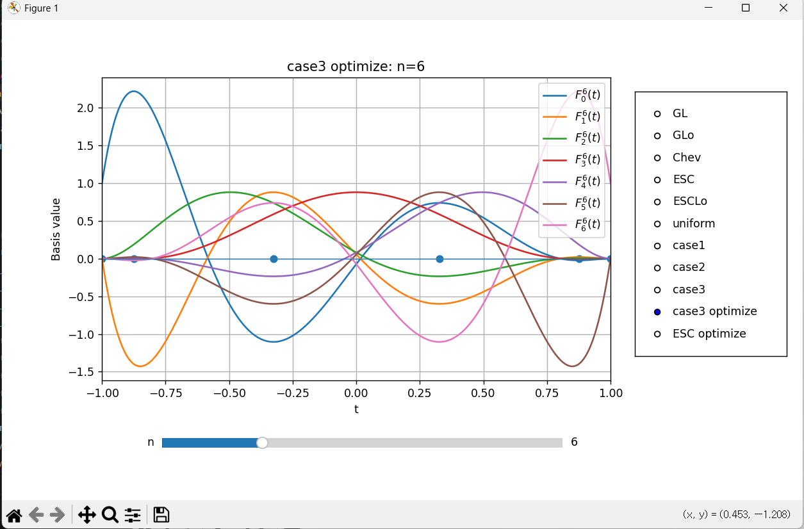
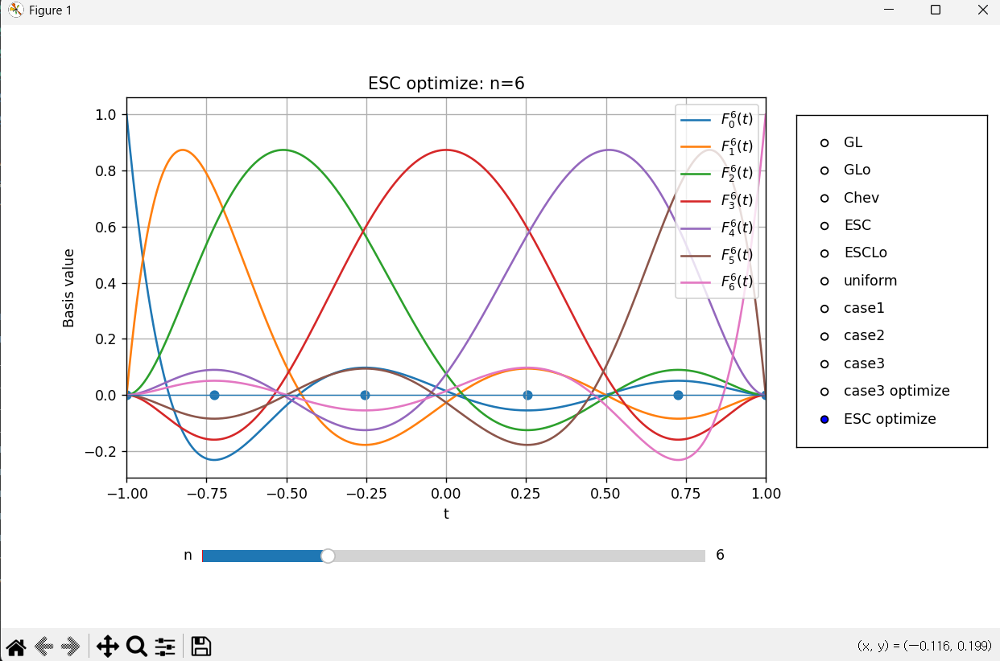

---

### 관찰 결과

분산의 국소 최솟값이 여러개 존재하더라도 전역 최솟값은 양수 영역에서 나타날 것이다.
-> n = 7 인 경우, 그렇지 않음이 나타남
-> 1. compass serach의 한계로 인해 명제가 참이지만 그렇게 보이지 않음
-> 2. 전역 최솟값은 여러개 존재할 수 있음

그렇다면 새로운 추측
양수 가중치 영역에서 국소 최솟값은 하나이다?

- 가중치가 양수인 공간은 연결 공간이다.
- 가중치가 양수인 공간은 하나의 국소 최솟값을 갖는다.
- 가중치가 양수인 공간의 국소 분산 최솟값은 t*에 의해서 발생한다.
- t* 에서 항상 최댓값이 결정되는 공간은?
- 분산의 국소 최솟값은 0이다.
- compass search의 오차는 어느정도인가? 얼마나 신뢰해야하는가 → 아래 "ver1의 한계와 개선" 참고
- 양수 가중치에서 갖는 최댓값이 차수와 무관하게 0.87 $\cdots$
GL basis의 상한과 비슷?
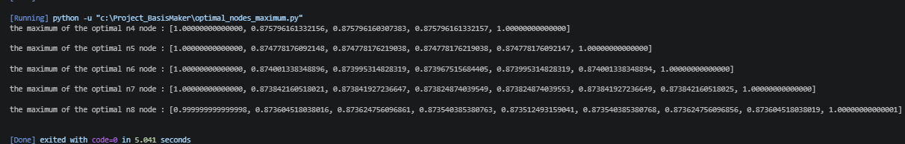
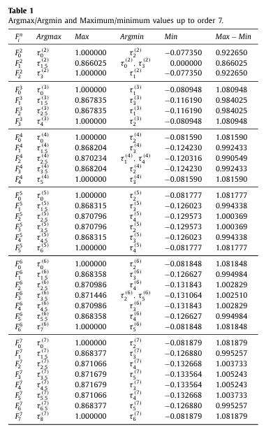
   

# ver1의 한계와 개선

### ver1(`compass_search`)의 한계 (2026-11-14)
- `nBig.py` (n = 10 ~ 20, $h = 10^{-3} \to 10^{-8}$, 고정밀 분산 dps = 40)를 9시간 넘게 돌렸지만 끝난 n이 하나도 없어 중단했다.
- 코드 오류는 아니다. n = 10을 단계별로 보면 $h$를 한 자리 줄일 때마다 걸음 수가 수십 배 늘어난다.

  | $h$ | 걸음 수 | 분산 |
  | --- | --- | --- |
  | $10^{-3}$ | 2 | $4.4\times10^{-5}$ |
  | $10^{-4}$ | 60 | $1.9\times10^{-5}$ |
  | $10^{-5}$ | 1732 이상 (4분 안에 끝나지 않음) | $8.0\times10^{-6}$ |

- 분산이 내려가는 골짜기가 좌표축 방향이 아니라서, 쌍 하나씩만 움직이면 아주 작은 걸음으로 지그재그로 따라가야 한다.
  ver1이 극소점 근처에서 일찍 멈추는 것(아래 관찰 결과 3)도 같은 원인이다.

### 개선
- **ver2 (`compass_search_ver2`)**
  - 축 방향이 모두 실패하면 대각선(쌍 두 개를 동시에, 모든 쌍 조합 $4\binom{k}{2}$개)을 탐색한다. $k = (n-2)/2$의 내림은 대칭 쌍의 개수다.
  - 그것도 실패하면 $h$를 $1/10$이 아니라 $1/2$로 줄인다.
  - 직전에 성공한 이동을 먼저 시도한다(모멘텀).
  - 왔던 방향(분산이 더 큰 것을 이미 앎)은 계산하지 않는다.
  - 후보 중 가장 좋은 것으로 움직인다(best improvement).
- **ver3 (`compass_search_ver3`)**
  - ver2와 같지만, 분산이 작아지는 후보를 찾는 즉시 움직인다(first improvement).
  - 성공한 이동은 후보 목록의 맨 앞으로 옮겨, 다음 걸음에서 가장 먼저 시도한다.
- 대각선 탐색에서 성공한 이동은 거의 모두 이웃한 쌍 $(i, i+1)$이었다 (n = 10: 372회 중 371회, n = 14: 128회 중 127회).

### 비교 (n = 6 ~ 9)
- 설정: ESC 노드를 대칭으로 맞춘 초깃값, $h = 10^{-3} \to 10^{-8}$, 고정밀 분산(dps = 40), 동시에 3개씩 실행.
- ver1은 $h$를 $1/10$씩 줄여 $10^{-9}$에서, ver2/ver3는 $1/2$씩 줄여 $7.6\times10^{-9}$에서 끝난다.

**실행 시간 (분산 계산 횟수 / 반복 횟수)**

| n | ver1 | ver2 | ver3 | ver1 → ver3 | ver2 → ver3 |
| --- | --- | --- | --- | --- | --- |
| 6 | 10.6초 (4285 / 1071) | 0.9초 (308 / 56) | **0.6초** (261 / 57) | 18배 | 1.5배 |
| 7 | 14.4초 (5005 / 1251) | 3.0초 (819 / 159) | **1.6초** (427 / 159) | 9배 | 1.9배 |
| 8 | 328.5초 (73279 / 12213) | 17.9초 (3284 / 262) | **8.4초** (1977 / 271) | 39배 | 2.1배 |
| 9 | 225.4초 (55891 / 9315) | 48.3초 (8577 / 885) | **15.6초** (3285 / 906) | 14배 | 3.1배 |

**최종 분산 (ESC → 도착점)**

| n | ESC | ver1 | ver2 | ver3 |
| --- | --- | --- | --- | --- |
| 6 | $4.97\times10^{-4}$ | $1.3\times10^{-14}$ | $1.03\times10^{-17}$ | $1.03\times10^{-17}$ |
| 7 | $5.19\times10^{-5}$ | $5.9\times10^{-15}$ | $2.19\times10^{-16}$ | $2.19\times10^{-16}$ |
| 8 | $2.27\times10^{-4}$ | $2.2\times10^{-13}$ | $5.47\times10^{-15}$ | $5.47\times10^{-15}$ |
| 9 | $5.72\times10^{-5}$ | $5.0\times10^{-14}$ | $1.98\times10^{-14}$ | $1.98\times10^{-14}$ |

**도착 노드 (양수 쪽, 1 제외. 모두 정확히 대칭이고, 홀수 n은 가운데 0)**

| n | ver1 | ver2 | ver3 |
| --- | --- | --- | --- |
| 6 | 0.2540807424, 0.7259023676 | 0.2540806011, 0.7259022633 | 0.2540806011, 0.7259022633 |
| 7 | 0.4256075379, 0.7927735458 | 0.4256073739, 0.7927734749 | 0.4256073739, 0.7927734749 |
| 8 | 0.1905361174, 0.5440318174, 0.8386449350 | 0.1905352617, 0.5440304251, 0.8386444410 | 0.1905352617, 0.5440304251, 0.8386444410 |
| 9 | 0.3319877653, 0.6297718147, 0.8701554816 | 0.3319874259, 0.6297714700, 0.8701553679 | 0.3319874259, 0.6297714700, 0.8701553679 |

### 관찰 결과
1. **ver3가 가장 빠르다.** ver1보다 9 ~ 39배, ver2보다 1.5 ~ 3.1배 빠르다. n이 클수록 ver2 대비 이득이 커진다 (후보가 많을수록 즉시 움직이는 효과가 크다).
2. **ver2와 ver3는 같은 점에 도착한다.** 노드는 표시한 10자리까지 같고, 분산은 8자리 이상 같다.
3. **ver1은 극소점 근처에서 멈춘다.** ver1의 노드는 ver2/ver3와 소수 6 ~ 7자리에서 달라지고 ($10^{-7}\sim10^{-6}$ 차이), 분산도 2.5 ~ 1300배 크다.
4. **반복 횟수보다 걸음당 계산 횟수가 줄었다.** ver3의 반복 횟수는 ver2와 비슷하거나 조금 많지만(n = 9: 906 대 885), 분산 계산 횟수는 절반 이하이다.
5. **n이 크면 대각선 후보가 많아진다.** n = 20이면 $4\binom{9}{2} = 144$개이고 분산 1회에 약 0.19초라, 축 방향이 실패할 때마다 최대 약 27초가 든다. n = 10 ~ 20에서의 실행 시간은 아직 재지 않았다.

### 다음에 해볼 것
- 대각선을 이웃한 쌍만으로 줄이기 ($4(k-1)$개, n = 20에서 32개).
- 모멘텀을 Hooke–Jeeves의 패턴 이동(지난 몇 걸음의 이동 전체를 한 번 더 적용)으로 넓히기.
- **노드 충돌 막기.** 노드 순서를 `node[i] < node[i+1]`로만 검사하므로, 두 노드가 가까워지는 쪽이 내리막이면
  float 반올림 때문에 간격이 $10^{-16}$ 수준까지 붙은 채로 끝날 수 있다 (ver1에서 n = 6, 시작점의 47%).
  이 상태는 가중치가 $10^{15}$ 수준으로 커져 결과를 믿을 수 없다. ver2/ver3에도 같은 검사가 남아 있다.
  검사에 여유를 두고(`node[i] + eps < node[i+1]`, 예: `eps = 1e-12`), 끝난 뒤 `min(np.diff(node)) < 2*h_limit`이면 경계 수렴으로 표시한다.
- ~~`nBig.py`를 ver3로 바꾸고, 캐시 `settings()`에 탐색 방식을 넣어 ver1 결과와 섞이지 않게 하기.~~ → 아래 "n = 10 ~ 15 결과 (ver3)"

   

# n = 10 ~ 15 결과 (ver3, 2026-11-14)

### 실험 방법
- `nBig.py`: `compass_search_ver3`, ESC 노드를 대칭으로 맞춘 초깃값, $h = 10^{-3} \to 10^{-8}$ (절반씩, 마지막 $h = 7.6\times10^{-9}$), 고정밀 분산(dps = 40)
- n 6개를 동시에 실행 (물리 코어 4개). n = 10, 11이 먼저 끝난 뒤로는 나머지가 코어를 덜 나눠 썼으므로 실행 시간은 대략적인 비교용이다.
- 60초마다 탐색 상태를 `variance_cache/nBig/n{n}.partial.json`에 저장해 중단해도 이어서 계산할 수 있다. 결과는 `variance_cache/nBig/n{n}.json`.

### 실행 시간과 분산

| n | 반복 횟수 | 실행 시간 | ESC 분산 | 도착점 분산 | 도착점 / ESC |
| --- | --- | --- | --- | --- | --- |
| 10 | 1587 | 2.5분 | $1.389\times10^{-4}$ | $4.05\times10^{-14}$ | $2.9\times10^{-10}$ |
| 11 | 3602 | 4.0분 | $5.526\times10^{-5}$ | $5.96\times10^{-14}$ | $1.1\times10^{-9}$ |
| 12 | 4631 | 14.2분 | $9.910\times10^{-5}$ | $1.11\times10^{-13}$ | $1.1\times10^{-9}$ |
| 13 | 8822 | 20.0분 | $5.138\times10^{-5}$ | $1.79\times10^{-13}$ | $3.5\times10^{-9}$ |
| 14 | 11800 | 36.6분 | $7.727\times10^{-5}$ | $3.74\times10^{-13}$ | $4.8\times10^{-9}$ |
| 15 | 18829 | 58.9분 | $4.725\times10^{-5}$ | $5.55\times10^{-13}$ | $1.2\times10^{-8}$ |

### 도착점의 성질

| n | 최댓값 평균 | 최댓값 범위 (max − min) | 최소 가중치 | 최소 노드 간격 |
| --- | --- | --- | --- | --- |
| 10 | 0.8734241059 | $5.4\times10^{-7}$ | 0.0313 | 0.106 |
| 11 | 0.8734068952 | $6.4\times10^{-7}$ | 0.0261 | 0.089 |
| 12 | 0.8733442213 | $9.1\times10^{-7}$ | 0.0221 | 0.076 |
| 13 | 0.8733381805 | $1.2\times10^{-6}$ | 0.0190 | 0.065 |
| 14 | 0.8733005519 | $1.7\times10^{-6}$ | 0.0165 | 0.056 |
| 15 | 0.8732995226 | $2.2\times10^{-6}$ | 0.0144 | 0.050 |

최댓값은 내부 $F_1 \sim F_{n-1}$의 최댓값이다.

### 도착 노드 (양수 쪽, 1 제외. 모두 정확히 대칭이고, 홀수 n은 가운데 0)

| n | 노드 |
| --- | --- |
| 10 | 0.1503768109, 0.4412502870, 0.6935015226, 0.8935718339 |
| 11 | 0.2716349866, 0.5256676499, 0.7421378177, 0.9109066626 |
| 12 | 0.1259473432, 0.3693926819, 0.5930571473, 0.7801146976, 0.9244694352 |
| 13 | 0.2305454827, 0.4494824066, 0.6468848493, 0.8102533463, 0.9350210708 |
| 14 | 0.1074744993, 0.3187408610, 0.5155367643, 0.6910597370, 0.8346353477, 0.9435805711 |
| 15 | 0.2000295218, 0.3929031486, 0.5706500588, 0.7273037657, 0.8545690445, 0.9504806873 |

### 관찰 결과
1. **모든 n에서 끝까지 수렴했다.** ver1으로 9시간 넘게 끝나지 않던 계산이 n = 10 ~ 15 전체 1시간 안에 끝났다.
2. **분산은 ESC보다 $10^{8}\sim10^{10}$배 작아졌다.** 도착점 분산은 n이 클수록 조금씩 커지는데($4\times10^{-14} \to 6\times10^{-13}$), 같은 $h$ 해상도에서 노드가 많을수록 남는 오차가 커지는 것으로 보인다.
   "분산의 국소 최솟값은 0이다" 추측과 어긋나지 않는다.
3. **최댓값이 거의 같은 높이로 맞춰진다.** 범위가 $10^{-6}$ 수준이고, 평균은 n에 따라 0.87342 → 0.87330으로 아주 조금씩 줄어든다.
   위 "관찰 결과"의 "양수 가중치에서 갖는 최댓값이 차수와 무관하게 0.87…"과 같은 값이다.
4. **가중치는 모두 양수이다.** 최소 가중치는 n이 커질수록 줄어든다 (0.0313 → 0.0144). 가장 작은 가중치는 모든 n에서 끝점 $\pm1$의 가중치이고, 그다음 노드의 가중치보다 5배 이상 작다.
5. **노드가 겹치지 않는다.** 최소 노드 간격은 0.05 이상으로, 노드 충돌 문제("ver1의 한계와 개선"의 "다음에 해볼 것")는 생기지 않았다.
6. **실행 시간은 n이 1 늘 때 약 1.6배씩 늘었다.** 이 비율이 이어진다고 가정하면 n = 20은 n 하나에 수 시간 ~ 10시간 정도로 예상된다 (측정하지 않은 추정).

   

# 고민

1. 최댓값을 갖는 점이 여러개인 경우에는 어떤 점을 해당 $$F_i^n$$의 maximizer로 선택할 것인가 -> 근데 이걸 고민해야 되나?
2. 가중치가 양수임을 가정하면 내분점임을 보장할 수 있지만, 내분점과 외분점으로는 가중치를 보장할 수 없음. -> 이걸 잘 알아보면 양수 가중치 조건을 찾는데 도움이 될지도