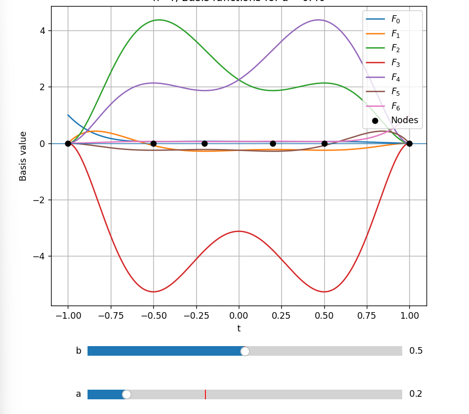

<h1 style="background-color: rgb(134, 227, 182); color: rgb(0, 0, 0)"> Cirtical Point Problem <h1>

# Definitions

Let $\{\tau_1, \tau_2, \dots, \tau_n\}$ be the arbitrary distinct ordered nodes with $\tau_i \in [-1, 1]$.

### Lagrange polynomial $L_i^n(t)$ associated with $\tau_i$

$$
L_i^n(t) = \prod_{\substack{j=1\\j\ne i}}^n \frac{t-\tau_j}{\tau_i-\tau_j}, \qquad i=1,\dots,n.
$$

For convenience, define $D_i^n = \prod_{\substack{j=1\\j\ne i}}^n (\tau_i-\tau_j)$.

### Quadrature weight $\omega_i^n$ associated with $\tau_i$

$$
\omega_i^n = \int_{-1}^{1} L_i^n(t)\,dt, \qquad i=1,\dots,n.
$$

### Normalized Lagrange polynomial $\tilde L_i^n(t)$

Throughout, we assume $\omega_i^n\ne0$ for all $i=1,\dots,n$, so that $\tilde L_i^n$ is well defined. (For arbitrary nodes the weights may be negative, but they must not vanish.)

$$
\tilde L_i^n(t) = \frac{L_i^n(t)}{\omega_i^n}, \qquad i=1,\dots,n.
$$

### Cumulative Lagrange polynomial $G_i^n(t)$

$$
G_i^n(t)=\int_{-1}^{t}\tilde L_i^n(s)\,ds-\frac12, \qquad i=1,\dots,n.
$$

For the endpoint indices, define $G_0^n(t)=\frac12$ and $G_{n+1}^n(t)=-\frac12$.

### Basis polynomial $F_i^n(t)$

$$
F_i^n(t)=G_i^n(t)-G_{i+1}^n(t), \qquad i=0,1,\dots,n.
$$

For $i=1,\dots,n-1$, the constants $-\frac12$ cancel, so

$$
\begin{aligned}
F_i^n(t)&=\int_{-1}^{t}\frac{L_i^n(s)}{\omega_i^n}\,ds-\int_{-1}^{t}\frac{L_{i+1}^n(s)}{\omega_{i+1}^n}\,ds\\
&=\int_{-1}^{t}\left(\frac{L_i^n(s)}{\omega_i^n}-\frac{L_{i+1}^n(s)}{\omega_{i+1}^n}\right)ds,
\qquad i=1,\dots,n-1.
\end{aligned}
$$

For the endpoint indices,

$$
F_0^n(t)=1-\int_{-1}^{t}\tilde L_1^n(s)\,ds,\qquad
F_n^n(t)=\int_{-1}^{t}\tilde L_n^n(s)\,ds.
$$

   

# Critical points of $F_i^n(t)$ with the ordered nodes $\{\tau_1,\tau_2,\dots,\tau_n\}$

## 1) $i=1,\dots,n-1$

$$
\begin{aligned}
\frac{d}{dt}F_i^n(t)=0
&\iff \frac{L_i^n(t)}{\omega_i^n}=\frac{L_{i+1}^n(t)}{\omega_{i+1}^n}\\
&\iff \prod_{\substack{j=1\\j\notin\{i,i+1\}}}^{n}(t-\tau_j)\left\{\alpha(t-\tau_{i+1})-\beta(t-\tau_i)\right\}=0,
\end{aligned}
$$

where $\alpha=\frac{\omega_{i+1}^n}{D_i^n}$ and $\beta=\frac{\omega_i^n}{D_{i+1}^n}$.

If $\alpha\ne\beta$, the critical points are $t=\tau_k$ for $k\ne i,i+1$, or

$$
t=t^*:=\frac{\alpha\tau_{i+1}-\beta\tau_i}{\alpha-\beta}.
$$

## 2) $i=0,n$

$$
\frac{d}{dt}F_0^n(t)=-\tilde L_1^n(t)\quad\Rightarrow\quad t=\tau_2,\tau_3,\dots,\tau_n,
$$

$$
\frac{d}{dt}F_n^n(t)=\tilde L_n^n(t)\quad\Rightarrow\quad t=\tau_1,\tau_2,\dots,\tau_{n-1}.
$$

There does not exist $t^*$ at the endpoint basis indices.

   

# Special cases of $t^*$

## 1) $\alpha=\beta$

In this case,

$$
(\alpha-\beta)t=\alpha\tau_{i+1}-\beta\tau_i=\alpha(\tau_{i+1}-\tau_i)\ne0,
$$

so the linear equation determining the additional critical point has no real solution. Thus $F$ only has $n-2$ critical points.

## 2) $t^*=\tau_k$, $k\ne i$, $k\ne i+1$

In this case, $\frac{d}{dt}F$ has a double root at $\tau_k$.

      

# Sign of $\frac{d^2}{dt^2}F_i^n(\tau_k)$, $k\ne i$, $k\ne i+1$

Assume $\omega_j^n>0$ for all $j=1,\dots,n$ throughout this section.

Consider

$$
\frac{d}{dt}\tilde L_i^n(t)=\frac{1}{\omega_i^nD_i^n}\frac{d}{dt}\left(\prod_{\substack{j=1\\j\ne i}}^n(t-\tau_j)\right).
$$

$$
\frac{d}{dt}\tilde L_i^n(\tau_k)=\frac{1}{\omega_i^nD_i^n}\prod_{\substack{j=1\\j\ne i,k}}^n(\tau_k-\tau_j).
$$

Since the nodes are ordered, the sign of the product is determined by the number of negative terms. It is $n-k-1$ if $k<i$ and $n-k$ if $k>i+1$. The number of negative terms in $D_i^n$ is $n-i$.

Then the sign of $\frac{d}{dt}\tilde L_i^n(\tau_k)$ is determined by $2n-i-k-1$ or $2n-i-k$ negative terms with positive weights. Since $2n$ is always even, the sign is determined by $i$ and $k$.

Similarly, the sign of $\frac{d}{dt}\tilde L_{i+1}^n(\tau_k)$ is determined by $i$ and $k$ and is opposite to that of $\frac{d}{dt}\tilde L_i^n(\tau_k)$.

By the definition of $F_i^n$, the sign of $\frac{d^2}{dt^2}F_i^n(\tau_k)$, $k\ne i,k\ne i+1$, is as follows.

| Position of $k$ | $i+k$ | Sign of $\frac{d^2}{dt^2}F_i^n(\tau_k)$ |
| --- | --- | --- |
| $k<i$ | even | $(-1)^{i+k+1}=-1$ |
| $k<i$ | odd | $(-1)^{i+k+1}=+1$ |
| $k>i+1$ | even | $(-1)^{i+k}=+1$ |
| $k>i+1$ | odd | $(-1)^{i+k}=-1$ |

## Endpoint indices $i=0,n$

The endpoint definitions $G_0^n=\frac12$ and $G_{n+1}^n=-\frac12$ are constant. Hence

$$
(F_0^n)''(t)=-(\tilde L_1^n)'(t),\qquad
(F_n^n)''(t)=(\tilde L_n^n)'(t).
$$

For $k=2,\dots,n$, the numerator of $(\tilde L_1^n)'(\tau_k)$ has $n-k$ negative factors, while $D_1^n$ has $n-1$. Since $\omega_1^n>0$,

$$
\operatorname{sgn}(F_0^n)''(\tau_k)=(-1)^k.
$$

For $k=1,\dots,n-1$, the numerator of $(\tilde L_n^n)'(\tau_k)$ has $n-k-1$ negative factors, while $D_n^n$ has none. Since $\omega_n^n>0$,

$$
\operatorname{sgn}(F_n^n)''(\tau_k)=(-1)^{n-k-1}=(-1)^{n+k+1}.
$$

Thus the table above also holds at $i=0$ (only $k>i+1$) and $i=n$ (only $k<i$). Together, it covers $i=0,\dots,n$ and the applicable node critical points.

   

# Position of $t^*$

- t* is defined under $\omega \neq 0$
- $D_i^n \neq 0$ with the distinct node
- So, $\alpha \neq 0$ and $\beta \neq 0$
- $
\alpha\beta=\frac{\omega_{i+1}^n}{D_i^n}\frac{\omega_i^n}{D_{i+1}^n}.
$

$t^*$ divides the segment from $\tau_i$ to $\tau_{i+1}$ in the ratio $\alpha:-\beta$. We can consider 3 cases.
1. $t^*$ lies on $\tau_i$ or $\tau_{i+1}$.
2. $t^*$ is the internal division point of  $\tau_i$ and $\tau_{i+1}$.
3. $t^*$ is the external division point of  $\tau_i$ and $\tau_{i+1}$. 

### 1. $t^*$ lies on $\tau_i$ or $\tau_{i+1}$ 
Since $\alpha \neq 0$ and $\beta \neq 0$, this case is impossible.

### 2. $t^*$ is the internal division point of  $\tau_i$ and $\tau_{i+1}$.
$
   \iff \alpha(-\beta) > 0 
\\ \iff \alpha\beta < 0
\\ \iff \omega_i^n \omega_{i+1}^n > 0 \qquad \because D_i^n D_{i+1}^n < 0
\\ \iff \omega_i^n$ and $ \omega_{i+1}^n$ has the same sign.

### 3. $t^*$ is the external division point of  $\tau_i$ and $\tau_{i+1}$.
$
   \iff \alpha(-\beta) < 0 
\\ \iff \alpha\beta > 0
\\ \iff \omega_i^n \omega_{i+1}^n < 0 \qquad \because D_i^n D_{i+1}^n < 0
\\ \iff \omega_i^n$ and $ \omega_{i+1}^n$ has different signs.
$\\ \Longrightarrow \exist \omega <0$ 

### useful facts
1. Under the positive weights condition, $t^*$ is always the internal division point
2. With distinct nodes, If $t^*$ is the external division point, then there exists  nonpositive weight.

   

# New notation of $t^*$

Under the positive weight condition, $t^*$ is the internal point of $\tau_i$ and $\tau_{i+1}$. So from now on, we denote $t^*$ by $\tau_{i+0.5}$, because in many examples it is more understandable. It does not mean the geometrical midpoint of $\tau_i$ and $\tau_{i+1}$.

   

# $t^*$ is the local maximizer

For $i=1,\dots,n-1$, assume that all quadrature weights are positive. By the interpolation property of the Lagrange polynomials,

$$
\frac{d}{dt}F_i^n(\tau_i)=\frac{1}{\omega_i^n}>0,
\qquad
\frac{d}{dt}F_i^n(\tau_{i+1})=-\frac{1}{\omega_{i+1}^n}<0.
$$

Since $t^*=\tau_{i+0.5}$ is the unique critical point in $(\tau_i,\tau_{i+1})$, the derivative changes from positive to negative at $t^*$. Therefore, $t^*$ is a local maximum point of $F_i^n$.

   

# $t^*$ is not necessarily a global maximizer

Even if the nodes are symmetric about zero, include both endpoints, and have positive quadrature weights, $t^*$ need not be a global maximizer on $[-1,1]$.

For example, consider the six nodes

$$
(\tau_1,\dots,\tau_6)=\left(-1,-\frac12,-\frac15,\frac15,\frac12,1\right).
$$

Their quadrature weights are all positive:

$$
(\omega_1^6,\dots,\omega_6^6)=\left(\frac{17}{108},\frac{128}{189},\frac{125}{756},\frac{125}{756},\frac{128}{189},\frac{17}{108}\right).
$$

The corresponding basis polynomial is

$$
F_3^6(t)=-\frac{25}{8}(t^2-1)^2(8t^2+1).
$$

Its critical point between $\tau_3$ and $\tau_4$ is $t^*=0$, which is a local maximum. However,

$$
F_3^6(0)=-\frac{25}{8}<0=F_3^6(-1)=F_3^6(1).
$$

Thus $t^*$ is not a global maximizer on $[-1,1]$.

   

<h1 style="background-color: rgb(134, 227, 182); color: rgb(0, 0, 0)"> Minimize Variance Problem <h1>

# Minimizing the varinace of the maximums of F

We assume following things.
- If the maximums of the bases has the similar values, then the curve is more predictable.
- As same, If the variance of the maximuns of bases has the minimum value, then the curve is more predictable.
- If the maximums of the inner bases has the similar values, then the minimums of the inner bases are also similar.

   

# Definitions

### Inner bases
we call the bases without the end index $F_1^n, F_2^n, \dots, F_{n-1}^n$ as the inner bases

### Maximum of the basis
Let $\tau$ is the strictly increaing node.  
Define the maximum of the basis $F_i^n$ for $i = 0, 1, \dots, n$ 
$$M_i^n(\tau) = \operatorname{max}_{t\in{-[-1,1]}} F_i^n(t)$$

### Average and Variance of the maximums
Define the average $\bar{M}(\tau)$ and the variance $\operatorname{Var}(\tau)$ of the maximums of the bases.

   

# Program Design
1. Set $\tau$ 
2. Get $\operatorname{Var}(\tau)$

   

# 고민

1. 최댓값을 갖는 점이 여러개인 경우에는 어떤 점을 해당 $$F_i^n$$의 maximizer로 선택할 것인가 -> 근데 이걸 고민해야 되나?
2. 가중치가 양수임을 가정하면 내분점임을 보장할 수 있지만, 내분점과 외분점으로는 가중치를 보장할 수 없음. -> 이걸 잘 알아보면 양수 가중치 조건을 찾는데 도움이 될지도